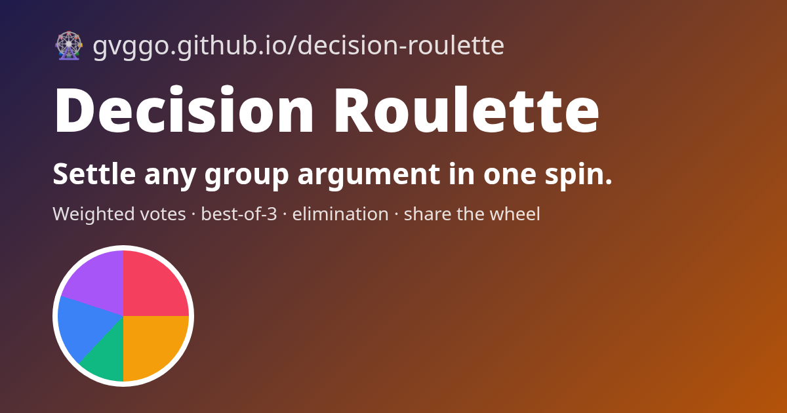

# 🎡 Decision Roulette

**Settle any group argument in one spin — weighted votes, best-of-3, elimination mode, and a link that shares your exact wheel.**

▶ **Spin:** https://gvggo.github.io/decision-roulette/

## Features
- **Weighted slices:** give each option 1–5 "votes"; bigger weight = bigger slice = higher chance (shown as a % after the spin).
- **Three modes:** *One spin* · *Best of 3* (first to 2 wins) · *Elimination* (each spin knocks one out, last one standing wins).
- **Fun twists** (optional): "…but the person who suggested it pays."
- **Share the wheel:** the whole wheel (options, weights, mode) is encoded in the URL, e.g. `#o=Tacos*3|Pizza|Sushi&m=best3`. Send it to the group chat and everyone opens the same wheel.
- Presets: dinner, movie night, who does the dishes, weekend plans, yes/no.
- Keyboard: <kbd>Space</kbd> to spin.

## Fairness
Picks use `crypto.getRandomValues`. The winner is chosen first (weighted), then the animation computes a final angle that lands the pointer inside that slice — unit tests check across thousands of random spins that the wheel always visually lands on the chosen option and that weights are respected statistically.

## Run locally
Open `index.html`. Tests: `node tests/logic.test.mjs`.

## Privacy
No backend, no analytics. The wheel lives in the page link and `localStorage`.

## Tech
Vanilla HTML/CSS/JS + Canvas · GitHub Pages. Built with AI assistance as a portfolio project.

## License
MIT
